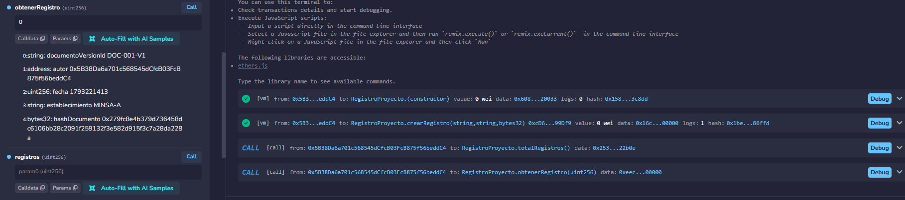
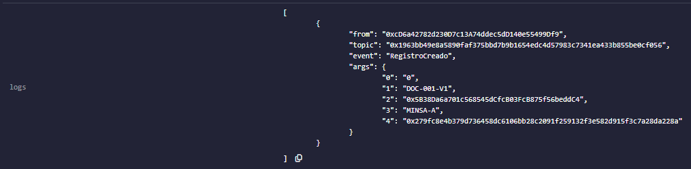
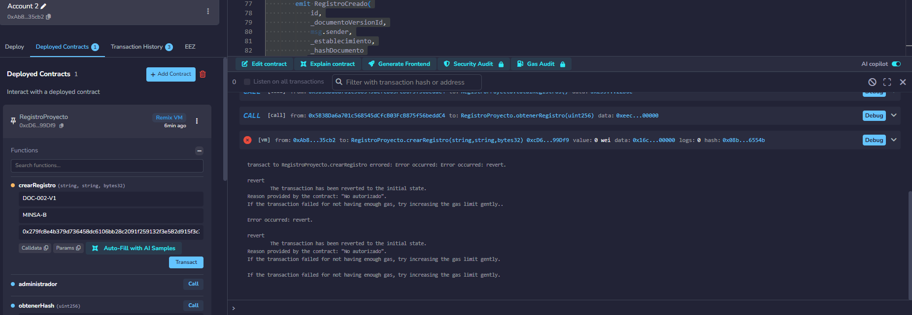
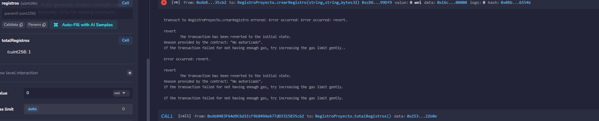
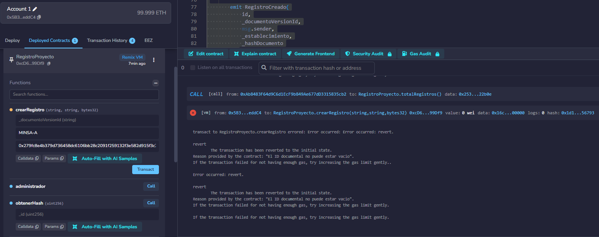
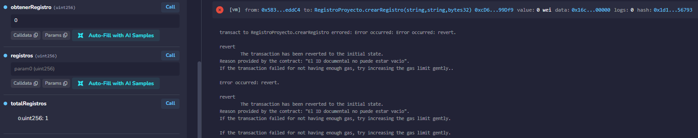

# Evidencias del laboratorio — Remix VM

Estas capturas fueron compartidas por el equipo durante la ejecución de las tres pruebas obligatorias. Se copiaron sin editar su contenido. Documentan el contrato final `RegistroProyecto` en Remix VM; no corresponden a la interfaz ni al despliegue posterior en Sepolia.

Dirección de la instancia de Remix VM utilizada: `0xcD6a42782d230D7c13A74ddec5dD140e55499Df9`.

## Datos sintéticos

- Identificador de versión documental: `DOC-001-V1`.
- Establecimiento: `MINSA-A`.
- Hash: `0x279fc8e4b379d736458dc6106bb28c2091f259132f3e582d915f3c7a28da228a`.

La huella es el SHA-256 del texto exacto `Documento sintetico MINSA A - version 1`, sin salto de línea final. El texto se mantiene fuera del contrato.

## 1. Dato válido

**Acción:** desde la cuenta que desplegó el contrato, ejecutar `crearRegistro` con los datos anteriores. Consultar `obtenerRegistro(0)` y abrir los logs de la transacción.

**Resultado observado:** la transacción termina correctamente y la lectura devuelve el identificador, el autor, la fecha, el establecimiento y el hash.

En los logs aparece `RegistroCreado` con el número `0` y los datos registrados.

## 2. Usuario sin permiso

**Acción:** seleccionar otra cuenta de Remix VM, sin volver a desplegar. Intentar `crearRegistro` con `DOC-002-V1`, `MINSA-B` y el mismo hash válido.

**Resultado observado:** el contrato revierte con `No autorizado`.

La consulta posterior de `totalRegistros` devuelve `1`: el intento no agregó un registro.

## 3. Dato inválido

**Acción:** volver a la cuenta administradora original. Ejecutar `crearRegistro` con el ID documental vacío, `MINSA-A` y el hash válido.

**Resultado observado:** el contrato revierte con `El ID documental no puede estar vacio`. Se utiliza el administrador para llegar a la validación del dato, sin que el control de acceso detenga primero la operación.

La consulta posterior de `totalRegistros` sigue devolviendo `1`: el intento inválido no agregó un registro.

## Reproducción por otro integrante o el profesor

1. Obtener el `EC2.sol` final exportado desde Remix. El archivo local `contracts/RegistroProyecto.sol` todavía es la plantilla del curso y debe sustituirse por la versión final antes de entregar.
2. Compilar el contrato con Solidity 0.8.24 y desplegar una copia nueva en Remix VM. La nueva dirección puede ser distinta de la capturada.
3. Conservar la cuenta de despliegue para el caso válido y comprobar que el contador pasa de 0 a 1.
4. Cambiar de cuenta para el caso sin permiso. Usar la misma instancia y comprobar que el contador continúa en 1.
5. Volver al administrador para el caso de ID vacío y comprobar nuevamente que el contador continúa en 1.

Las pruebas con una copia nueva en Remix VM no requieren MetaMask ni fondos reales. Las verificaciones de la interfaz con MetaMask en Sepolia se documentarán por separado cuando se ejecuten.
